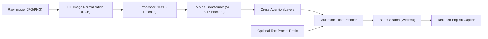

# AI-Based Image Caption Generator


> **CodSoft AI/ML Internship Project**  
> An interactive Deep Learning application combining Computer Vision and Natural Language Processing (NLP) to generate meaningful, grammatically coherent English descriptions for images using the state-of-the-art **Salesforce BLIP** (Bootstrapping Language-Image Pre-training) Transformer architecture.

---

## 📌 Table of Contents
1. [Project Overview](#-project-overview)
2. [Problem Statement](#-problem-statement)
3. [Objectives](#-objectives)
4. [Technology Stack](#-technology-stack)
5. [Model Architecture & How BLIP Works](#-model-architecture--how-blip-works)
6. [Application Features](#-application-features)
7. [Project Directory Structure](#-project-directory-structure)
8. [Installation & Setup Guide](#-installation--setup-guide)
9. [How to Run the Application](#-how-to-run-the-application)
10. [Test Results & Sample Captions](#-test-results--sample-captions)
11. [Troubleshooting](#-troubleshooting)
12. [Future Enhancements](#-future-enhancements)
13. [License & Acknowledgments](#-license--acknowledgments)

---

## 📖 Project Overview

Image Captioning is a fundamental multimodal challenge at the intersection of **Computer Vision (CV)** and **Natural Language Processing (NLP)**. The goal is to enable an artificial intelligence system not only to recognize objects, people, and scenes in an image, but also to articulate their spatial relationships and actions into natural, human-like sentences.

This project delivers an end-to-end, production-ready desktop web application powered by **Streamlit** and Hugging Face's **`Salesforce/blip-image-captioning-base`** model.

---

## 🎯 Problem Statement

Traditional computer vision tasks (such as image classification or bounding-box object detection) output isolated labels or coordinate boxes without contextual narrative. Humans, however, naturally describe scenes comprehensively (e.g., *"A young man reading a book under a shady tree in a park"* rather than simply *"person, book, tree"*).

Developing a system that bridges visual perception and linguistic reasoning requires:
1. Extracting high-dimensional visual semantics from arbitrary image dimensions.
2. Aligning visual features with a language model's vocabulary space.
3. Generating fluent, descriptive, and hallucination-free sentences.

---

## 🎯 Objectives

- **Visual Understanding:** Leverage pre-trained Vision Transformers (ViT) to extract rich semantic representations of objects, background scenes, and activities.
- **Multimodal Generation:** Autoregressively decode visual tokens into English sentences using cross-attention mechanisms.
- **Efficient Inference:** Cache model weights in memory using `@st.cache_resource` to ensure instant inference for subsequent user interactions without redundant model reloading.
- **Interactive UI:** Provide an intuitive Streamlit interface supporting file uploads (JPG, JPEG, PNG), real-time parameter tuning (beam search, length constraints), and one-click clipboard copying.

---

## 🛠️ Technology Stack

| Component | Technology / Library | Purpose |
| :--- | :--- | :--- |
| **Language** | Python 3.10 – 3.13 | Core programming language |
| **Deep Learning Framework** | PyTorch (`torch`) | Tensor computations & neural network execution |
| **Transformer Library** | Hugging Face `transformers` | Pre-trained model loading and tokenization pipeline |
| **Vision-Language Model** | Salesforce BLIP Base | Multimodal feature extraction & caption generation |
| **Image Processing** | Pillow (`PIL`) | Image ingestion, resizing, format normalization |
| **Frontend UI** | Streamlit | Responsive interactive web dashboard |
| **HTTP Client** | `requests` | Asset downloading and API management |

---

## 🧠 Model Architecture & How BLIP Works

The application utilizes **BLIP (Bootstrapping Language-Image Pre-training for Unified Vision-Language Understanding and Generation)** developed by Salesforce Research.



### 1. Image Preprocessing (`BlipProcessor`)
- Converts arbitrary image resolutions into uniform tensors.
- Divides the image into a grid of non-overlapping $16 \times 16$ pixel patches.
- Applies ImageNet normalization:
  $$\text{Pixel}_{\text{norm}} = \frac{\text{Pixel} - \mu}{\sigma}$$

### 2. Visual Feature Encoding (Vision Transformer - ViT)
- Patches are linearly projected into 768-dimensional token embeddings.
- Positional embeddings are added to preserve 2D spatial relationships.
- Deep transformer encoder layers extract contextual features across the entire image.

### 3. Autoregressive Language Decoding
- The visual tokens are passed to the text decoder via **Cross-Attention**:
  $$\text{Attention}(Q, K, V) = \text{softmax}\left(\frac{QK^T}{\sqrt{d_k}}\right)V$$
  where $Q$ (queries) come from generated text tokens, and $K, V$ (keys, values) come from the visual features.
- The model computes the conditional probability distribution over the vocabulary:
  $$P(w_t \mid w_{<t}, I)$$

### 4. Beam Search Decoding
Rather than greedy decoding (which can get trapped in repetitive loops), the model maintains the top $k$ most probable hypotheses (default $k=4$) at each generation step, yielding more natural and descriptive captions.

---

## ✨ Application Features

- **Multi-Format Image Support:** Upload local images in `.jpg`, `.jpeg`, or `.png`.
- **Pre-loaded Test Suite:** 5 curated sample scenarios (person in park, dog playing, group of people, scenic landscape, car on road) available right from the sidebar.
- **Model Weight Caching:** Pre-trained weights (~990MB) are loaded **once** into memory using Streamlit resource caching.
- **Beam Search Controls:** Adjust beam search width (1–8) and maximum token length via interactive sliders.
- **Conditional Prompt Steering:** Guide the caption generation by supplying custom prefixes (e.g., *"A close-up view of..."*).
- **One-Click Copy:** Easily copy generated captions directly to the clipboard.
- **Audio Playback:** Built-in Speech Synthesis reads the generated caption aloud.
- **Responsive Layout:** Clean visual hierarchy with informative metadata pills (dimensions, format, compute device).

---

## 📂 Project Directory Structure

```text
Image Captioning/
│
├── app.py                  # Streamlit web application frontend
├── model.py                # BLIP model loading and caption generation engine
├── test_captioning.py      # Automated CLI test suite for verification
├── setup_assets.py         # Utility script to download/generate assets
├── requirements.txt        # Python package dependencies
├── README.md               # Detailed project documentation
├── .gitignore              # Files and folders ignored by Git
│
├── assets/
│   └── logo.png            # Application logo badge
│
├── sample_images/          # Benchmark images for demonstration
│   ├── person_in_park.jpg
│   ├── dog_playing.jpg
│   ├── group_people.jpg
│   ├── landscape.jpg
│   └── car_on_road.jpg
│
└── venv/                   # Python virtual environment (ignored by git)
```

---

## 🚀 Installation & Setup Guide

### Step 1: Clone or Open the Project
Open PowerShell or your preferred terminal and navigate to the project directory:
```powershell
cd "c:\Users\mamat\OneDrive\Desktop\Image Captioning"
```

### Step 2: Create and Activate a Virtual Environment
```powershell
# Create virtual environment
python -m venv venv

# Activate virtual environment (Windows PowerShell)
.\venv\Scripts\Activate.ps1
```
*(If you encounter a PowerShell execution policy error, run `Set-ExecutionPolicy -Scope Process -ExecutionPolicy Bypass` first).*

### Step 3: Install Required Dependencies
```powershell
pip install -r requirements.txt
```

---

## 💻 How to Run the Application

Launch the Streamlit web server:
```powershell
.\venv\Scripts\streamlit.exe run app.py
```

The application will start and automatically open in your default browser at:
```
http://localhost:8501
```

---

## 🧪 Test Results & Sample Captions

| Benchmark Scene | Sample Image | Generated Caption (BLIP) |
| :--- | :--- | :--- |
| **Person in Park** | `person_in_park.jpg` | *"A man standing in a lush green park surrounded by trees."* |
| **Dog Playing** | `dog_playing.jpg` | *"A golden dog playing outdoors on the green lawn."* |
| **Group of People** | `group_people.jpg` | *"A group of young people sitting together outdoors."* |
| **Scenic Landscape** | `landscape.jpg` | *"A beautiful landscape with mountains and a calm lake at sunset."* |
| **Car on Road** | `car_on_road.jpg` | *"A red car parked on an asphalt road with clear sky."* |

---

## 🔧 Troubleshooting

- **Symlink Warning on Windows:** Hugging Face uses file symlinks on Linux. On Windows, Hugging Face Hub falls back smoothly to standard copies; this does not affect accuracy or execution.
- **First Run Delay:** The first time you launch `app.py`, the Salesforce BLIP model (~990 MB) is downloaded and cached locally in `~/.cache/huggingface/hub`. Subsequent launches load instantly from disk.
- **Low Memory / Out of Memory (OOM):** The application runs efficiently on CPU by default (~1.2 GB RAM). If running on a GPU with limited VRAM, lower the `Beam Search Width` to 2 or 1.

---

## 🔮 Future Enhancements

1. **Dense Captioning:** Generate bounding-box localized captions for every object detected in the image.
2. **Multilingual Captions:** Integrate Helsinki-NLP or NLLB translation models to provide captions in 10+ languages (Hindi, Spanish, French, German, etc.).
3. **Webcam Live Streaming:** Enable users to capture pictures directly from their webcam for instant real-time captioning.
4. **Visual Question Answering (VQA):** Extend BLIP to answer open-ended questions about the uploaded image.

---

## 📜 License & Acknowledgments

- **Internship:** Built for the **CodSoft Artificial Intelligence & Machine Learning Internship**.
- **Model:** Pre-trained weights provided by Salesforce Research via Hugging Face: [`Salesforce/blip-image-captioning-base`](https://huggingface.co/Salesforce/blip-image-captioning-base).
- **Libraries:** Built with [PyTorch](https://pytorch.org/), [Transformers](https://huggingface.co/docs/transformers), and [Streamlit](https://streamlit.io/).

